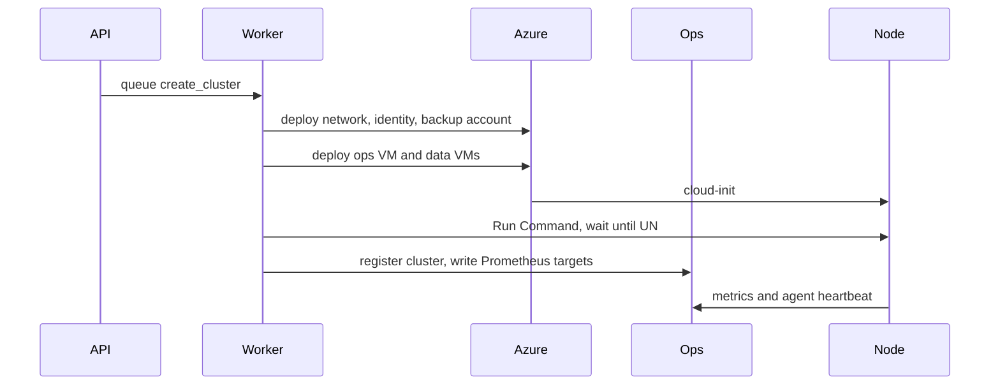

# Components

## Control plane

One Python 3.12 process.

| Module | Responsibility |
| --- | --- |
| `api` | Auth, request validation, handlers, OpenAPI, UI templates |
| `worker` | Pulls queued operations and runs them to a terminal state. A second loop classifies health |
| `store` | SQLite. Source of truth for desired cluster state, operations, and audit |
| `cloud` | Port with two adapters: `AzureCloud` (Bicep deployment, Compute, Run Command) and `FakeCloud` (tests) |

The worker is in-process for the demo. A crash mid-operation leaves the operation `running` with a `step` value. On startup the worker resumes or marks it `error` if the step is not idempotent. Each step is written before it starts, and each step can be retried.

## Data node

Ubuntu 24.04. cloud-init installs:

- ScyllaDB server from the distro repo recorded in `versions.env`
- `scylla-manager-agent`
- A data disk mount at `/var/lib/scylla`
- `scylla.yaml` with cluster name, the seed list, private `listen_address` and `rpc_address`, `api_address` on localhost, and `GossipingPropertyFileSnitch`
- `cassandra-rackdc.properties` with `dc=datacenter1` and `rack=rack1`
- The agent `azure.account` value for the backup account. The key field stays commented. The VM's user-assigned identity supplies access

Scylla Open Source, one datacenter, replication factor 3, `NetworkTopologyStrategy`. Authentication is enabled. A dedicated role `scylla_manager` is created for Manager and a role `demo_app` is created for the CQL client. Passwords are generated per cluster, stored in the control-plane database, and injected over Run Command. They are not written into the Bicep parameters file that CI logs.

## Ops VM

Docker on Ubuntu 24.04. Three workloads:

| Workload | Why it is here |
| --- | --- |
| Single-node Scylla container | Manager's private metadata database. It is not a member of the user cluster and is not backed up as user data |
| Scylla Manager | Schedules backup, restore, and repair. Talks to agents on port 10001 and to CQL on the data nodes |
| Monitoring stack | Pinned Scylla monitoring release, started with `start-all.sh`. The control plane writes the Scylla and node_exporter target files. Prometheus data stays on the host |

The assignment asks for Manager and the monitoring stack as Docker. Manager's documented install is an apt package plus `scyllamgr_setup`. We follow the assignment and keep the package install as a pre-approved fallback, recorded in the decision log, if the container cannot register a cluster or start a backup.

## How they meet

After provisioning, the UI does not SSH anywhere. Health comes from Azure power state plus a Manager or CQL probe issued from the ops VM via Run Command. Grafana is linked, not embedded, so we do not weaken Grafana's cookie settings for an iframe.

## CQL demo client

`clients/cql_demo` is a short Python program using the DataStax Cassandra driver, which speaks the CQL protocol Scylla implements. It creates keyspace `demo` if needed, writes one row, and reads it back. It uses `demo_app` and the node 0 address printed by the API. It is a client of the database, not of the control plane.
