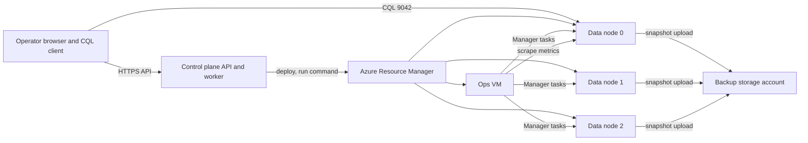

# Architecture overview

## Goal

A user can create one 3-node ScyllaDB cluster on Ubuntu 24.04 LTS, watch it become healthy, run a CQL read/write, back it up to Azure Blob, restore that backup, and recover from a single node failure. The same operations exist in a web UI and an HTTP API.

## Shape

The control plane is outside the cluster. It stores desired state and drives Azure. ScyllaDB nodes store user data. The ops VM stores management metadata, metrics, and dashboards. Backup blobs live in a second resource group so deleting the cluster does not immediately delete the only copy of the data.

## What we build

- A single-process control plane: HTTP API, server-rendered UI, and a background worker.
- Azure layouts expressed as Bicep modules, applied by the worker.
- cloud-init for Ubuntu 24.04 that installs ScyllaDB and the Manager agent on data nodes.
- A compose file on the ops VM for Manager and its metadata database. The pinned Scylla monitoring release is started with `start-all.sh`.
- Health classification and a node-replace procedure with a quorum guard.
- An append-only audit log of operator and automation actions.
- A small CQL client that inserts and reads a row.
- CI that tests the control plane without spending Azure money.

## What we reuse

- ScyllaDB's own packages, gossip, streaming, and node-replace boot flags for cluster membership.
- Scylla Manager for backup, restore, and scheduled repair. The agent on each data node performs the blob upload. The Manager server only coordinates.
- The Scylla Monitoring stack for Prometheus, Grafana, Alertmanager, and the shipped dashboards. Current upstream compose also runs Loki; we keep it and point node logs at it.
- Azure VM Run Command for one-off remote steps, so the control plane does not hold SSH keys.
- A user-assigned managed identity on the data NICs' VMs for blob access. Storage account keys are not written to disk.

## Trust boundaries

| Boundary | Rule |
| --- | --- |
| Internet to API | API key, then confirmation on delete, replace, and restore |
| Internet to nodes | Denied by default. Operator IP may reach CQL, Grafana, and the API only |
| Ops VM to data nodes | Metrics, Manager agent, and CQL on the private subnet |
| Data nodes to blob | Managed identity scoped to the backup container |
| Control plane to Azure | The operator's Azure login or a deployer service principal. This identity can create resources. It is not placed on the data VMs |

## Pinned external behavior

Checked against Scylla's stable docs on 2026-11-05:

- Manager backup to Azure is container-based. Each data node's agent config sets `azure.account`. Access is an RBAC role on the VM, not an account key. `scylla-manager-agent check-location --location azure:<container>` validates it.
- Manager's supported package install is `scylla-manager-server` from the 3.13 apt list, and it needs its own ScyllaDB to store management data.
- Monitoring is a Docker stack installed on a machine outside the Scylla cluster. Prometheus needs a targets file with the node IPs and the Manager IP.

Package and image versions are not hardcoded in this plan. Implementation writes them to `versions.env` after confirming the Ubuntu 24.04 repository URL and the Manager image tag. The decision log records the fallback if Manager-in-Docker cannot perform the registration and backup flow.
