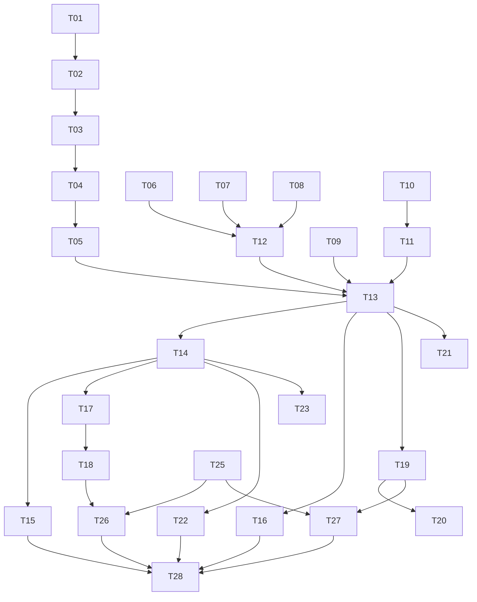

# Task backlog

Build order is the order below. A task is done when its acceptance lines are true and the docs it touches are updated if the task had to change a decision.

Demo checkpoint: T01 through T16. At that point a person can create a cluster from the UI and run the CQL client. The homework is complete after T28. T29 is hardening and may land after the demo if time is short.

## Foundation

### T01. Project skeleton

Create the tree in the [docs map](../README.md), `pyproject.toml` for Python 3.12, FastAPI process that serves `/healthz`, and `versions.env` with empty pins and comments.

Acceptance: `pytest` runs the health test. `uvicorn` serves `/healthz` locally.

### T02. Store and state machine

SQLite migrations for the tables in [data-model.md](../design/data-model.md). Store methods enforce the invariants: one live cluster, one running operation, append-only audit.

Acceptance: tests cover the legal status transitions and one illegal transition for each invariant.

### T03. Worker loop

In-process worker pulls a queued operation, sets `running`, dispatches on `type`, and resumes an operation left `running` if its step is marked idempotent.

Acceptance: a fake handler records steps. Killing the loop between steps and starting it again continues the operation. A handler exception sets `failed` and writes audit.

### T04. Auth and errors

Bearer API key, error JSON from [the API doc](../api/overview.md), audit on denial.

Acceptance: tests for 401, 400, and a redaction helper that strips known secret fields.

### T05. Cloud port

`Cloud` protocol and `FakeCloud`. Methods the workflows need: ensure group, deploy module, delete group, vm power state, start vm, delete vm keep nic, run command. `AzureCloud` can be a stub that raises `NotImplementedError` until T12.

Acceptance: the worker can run a create operation to `ready` entirely on `FakeCloud`, with node rows and host ids filled by the fake.

## Infrastructure

### T06. Network, identity, backup storage modules

Bicep for both resource groups' contents except VMs: VNet, subnet, NSG, NICs, public IPs, user-assigned identity, role assignment, storage account, container. Parameters match [topology.md](../architecture/topology.md).

Acceptance: `az bicep build` succeeds. A parameter file example has no secrets.

### T07. Data VM module

Ubuntu 24.04 Gen2, demo SKU, OS disk, data disk, identity attached, NIC attached, cloud-init custom data.

Acceptance: `az bicep build` succeeds. The module takes `replace_flag` and `replace_value` which may be empty.

### T08. Ops VM module

Ubuntu 24.04, Docker cloud-init, no public scrape ports beyond the NSG.

Acceptance: `az bicep build` succeeds.

### T09. Data-node cloud-init

Template from [provisioning.md](../workflow/provisioning.md). Pin packages from `versions.env`.

Acceptance: a shell-level render test produces yaml for ordinal 0 and for a replace boot. cloud-init schema check if the schema tool is available in CI; otherwise a yaml parse plus a grep for the required keys.

### T10. Ops compose

Compose file: metadata Scylla, Manager, monitoring stack wired the way the pinned monitoring release expects (`start-all.sh` or compose). Prometheus data directory on the host.

Acceptance: `docker compose config` succeeds on a machine with Docker. CI runs that only when Docker is available, and otherwise runs a yaml parse so forks without Docker still check structure.

### T11. Confirm versions

Fill `versions.env`: Ubuntu URN, Scylla apt list URL, Manager apt list or image tag, monitoring git tag, `SCYLLA_REPLACE_FLAG`. Record in the decision log whether Manager is Docker or the package fallback, after one real boot of the ops compose against the metadata container.

Acceptance: `versions.env` values are the ones used by T09 and T10, and the decision log says which Manager install won.

## Wire-up

### T12. AzureCloud

Implement the port with resource deployments and Run Command. Secrets passed to Run Command are not logged.

Acceptance: unit tests with recorded HTTP where practical; a manual note in the demo doc listing the one subscription used for the live run.

### T13. Create and delete workflows

Implement the step lists in [provisioning.md](../workflow/provisioning.md) and [lifecycle.md](../workflow/lifecycle.md) against the `Cloud` port. FakeCloud test walks every step. AzureCloud is what the manual demo uses.

Acceptance: FakeCloud create ends `ready` with three host ids, schedules recorded, and `io_profile` set. FakeCloud delete with `delete_backups=false` retains the backup group and sets `backup_retain_until`.

### T14. API handlers

Handlers from [api/overview.md](../api/overview.md) on top of the store and the queue. No Azure calls inside the request thread.

Acceptance: API tests cover create 202, second cluster 409, delete with wrong confirm 400, delete with right confirm 202.

### T15. UI

Pages `/`, `/clusters/{id}`, `/audit`. Poll operation and health. Disable buttons the API would reject. Show the in-place restore warning.

Acceptance: a test client loads the three pages against FakeCloud. The manual demo later repeats this in a browser.

### T16. CQL demo client

`clients/cql_demo` inserts a row into `demo.events` and reads it back. Flags for contact, username, password.

Acceptance: a test against a Cassandra-protocol fake or a skipped integration mark. The readme in that directory shows the exact command the demo uses. Live success is part of T28.

## Recovery, backup, audit

### T17. Health loop

Classification table in [failure-recovery.md](../workflow/failure-recovery.md). Power state every tick. Deep check on the conditions documented there.

Acceptance: FakeCloud tests for the four rows of the classification table, including freeze when two nodes are down.

### T18. Restart and replace

Workflows from the recovery doc, including the replace flag from `versions.env` and the Manager repair wait.

Acceptance: FakeCloud replace keeps the private IP, requires host id, and refuses when a peer is down.

### T19. Manager backup and restore

On-demand backup, scheduled task recording, restore gated by confirm, cluster status `restoring` during the operation.

Acceptance: Fake Manager tests for success, partial-node backup note, and restore confirm failure. Live proof is T28.

### T20. Audit completeness

Every action in [observability-and-audit.md](../workflow/observability-and-audit.md) is written. Scheduled backup detection is a health-loop observation of a new Manager run id.

Acceptance: a test enumerates action names from the doc and from the code and fails on drift. Secret redaction test from T04 extended to backup and restore bodies.

### T21. Monitoring targets

Render targets, copy to the ops VM, start or reload the stack, store the Grafana URL on the cluster.

Acceptance: a golden-file test of the targets render for the three static IPs.

## Delivery

### T22. CI

Workflow in [ci-and-demo.md](../delivery/ci-and-demo.md).

Acceptance: a pull request runs unit tests, bicep build, cloud-init parse, and the OpenAPI snapshot diff. It does not log into Azure.

### T23. OpenAPI snapshot

Export FastAPI's OpenAPI to `api/openapi.json` and fail CI on an uncommitted diff.

Acceptance: the snapshot matches the handlers. The API doc is updated in the same commit when a field changes.

### T24. Operator runbook

Short page `docs/delivery/runbook.md` written while doing the first live create: subscription, `OPERATOR_CIDR`, expected wait, how to read a failed cloud-init, how to delete if the UI is down (`az group delete` on both groups).

Acceptance: a person who did not write the code can follow it. Cost figure for the pinned SKUs included, computed that day.

### T25. Live create

Run the create workflow in the real subscription. Fix the plan where reality disagrees, in the decision log, not only in code.

Acceptance: cluster reaches `ready`. Grafana shows three nodes. Audit contains `cluster.create`.

### T26. Live failure

Stop one data VM from the API restart path, then delete one VM in the portal and watch replace. Then stop two VMs and show the freeze.

Acceptance: notes and timestamps pasted into the demo doc. Replace ends UN and a repair ran. Freeze audited as `critical`.

### T27. Live backup and restore

The five-step proof in [backup-and-restore.md](../workflow/backup-and-restore.md).

Acceptance: before and after read output saved in the demo notes. Blobs visible in the container.

### T28. Demo pass

One sitting, from empty subscription resources to delete, following the runbook. UI exercised in a browser: create, watch steps, open Grafana, run the client, restore, delete.

Acceptance: a checklist in `docs/delivery/demo-log.md` with the date and what broke.

### T29. Reconcile view

Read-only list of tagged resource groups versus SQLite. Surface orphans on the cluster list page. Do not delete them automatically.

Acceptance: a test with FakeCloud groups that are not in the database shows them as orphans.

## Dependency sketch

T06–T11 can proceed in parallel with T01–T05. Live tasks T25–T28 are serial and need a human with the subscription.
